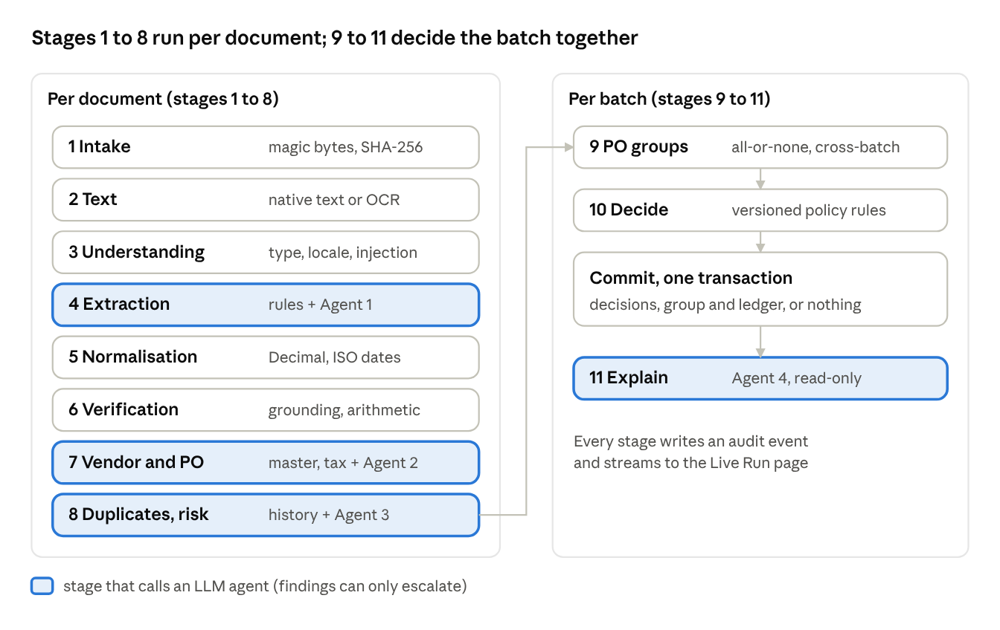

# Invoice → Decision: Technical Design (Zamp PS-1)

Updated 11 Nov 2026

## Overview

Invoice → Decision is a Python/Streamlit pipeline that turns invoice PDFs into one of five auditable AP decisions (AUTO_APPROVE, HOLD_FOR_REVIEW, PENDING_SPLIT_RECONCILIATION, REJECT_DUPLICATE, REJECT_INVALID). Its core rule: **agents investigate, deterministic code decides.** Four LLM agents read, investigate and explain; Decimal arithmetic, tolerances, duplicate keys, tax, PO consumption and the final policy are plain code. An agent finding can only escalate (add an ERROR finding), never approve or clear one.

| Layer | Choice |
| --- | --- |
| UI | Streamlit 1.x multipage app (Home.py + 5 pages) |
| PDF | PyMuPDF: magic-byte and corruption checks, native text with word boxes, page rendering |
| OCR | RapidOCR (ONNX runtime) at 300 dpi with coordinate deskew; pip-only, no system binary |
| Contracts | Pydantic v2 models; money as Decimal throughout |
| Matching | rapidfuzz for grounding and description matching |
| Rules | Versioned YAML (policy_rules.yaml, tolerance_rules.yaml) |
| Storage | SQLite, atomic transactions (BEGIN IMMEDIATE) |
| LLM | Provider interface: Gemini (google-genai) and one OpenAI-compatible adapter (Groq, OpenRouter, Ollama, any compatible endpoint), plus deterministic and mock providers |
| Fixtures | reportlab + Pillow generator for 27 synthetic PDFs |
| Tests | pytest, fully offline (mock provider, mocked HTTP) |

```
Home.py, pages/            Streamlit UI (live run, dashboard, review, PO groups, rules)
src/pipeline/              intake, text_acquisition, understanding, extraction_rules, normalization,
                           verification, matching, tax, duplicates, split_groups, policy_engine
src/agents/                base, 4 agents, providers/ (gemini, openai_compat, deterministic, mock)
src/orchestrator.py        runs the stages, emits live events, batch finalisation, atomic commits
src/storage.py             SQLite schema and access
config/                    policy_rules.yaml, tolerance_rules.yaml
data/                      vendors, POs, PO lines, history + ledger seeds, 27 invoice PDFs, scenarios
scripts/                   generate_fixtures.py, run_demo.py, check_llm.py
tests/                     normalisation, scenarios, agents, providers, tax
```

## Architecture

A batch runs in two phases: stages 1–8 per document, then a batch-level finalisation (stages 9–11) that reconciles PO groups across the batch and earlier uploads before any decision is written.



Only stages 4, 7, 8 and 11 call an LLM; every decision comes from stage 10, and stage 9 sees the whole batch plus earlier uploads.

- **Per document** (`process_document` → `_process`): intake, text acquisition, understanding, extraction (rules + Agent 1), normalisation, verification, vendor/PO matching (+ Agent 2), duplicates and risk (+ Agent 3). Each document is registered in `history` right after stage 8, so a later file in the same batch can be detected as its duplicate. Terminal failures (corrupt file, out of scope, no readable text) stop early with a REJECT_INVALID or HOLD path.
- **Per batch** (`finalize`): a pre-decision on each document's own findings excludes rejected ones from groups; documents referencing the same ONE_TIME PO are reconciled together with any open group from earlier batches; then the policy engine decides every member, and decisions, the group and ledger rows commit in **one SQLite transaction**. Standalone documents (blanket POs, no PO, terminal) are decided individually. Agent 4 explains each final decision last.
- **Live view:** every stage calls `Run.emit`, which appends the event to the document record, writes an `audit_events` row and invokes the UI callback. The Live Run page renders these as status boxes; `run_demo.py` prints the same events to the console.
- **Errors are visible:** an unexpected exception becomes a PIPELINE_ERROR finding and a failed stage event, never a silent pass.

## Data model and evidence contract

Every extracted value carries its evidence, and every check is a typed finding; the policy engine only ever sees findings. All models are Pydantic v2 in `src/models.py`.

| Model | Key fields | Role |
| --- | --- | --- |
| FieldEvidence | value, raw_text, source_page, bbox, method (native_text / ocr / llm), confidence, grounded, grounding_score, missing_reason, notes | One header field. A missing value is null with a reason, never guessed. |
| InvoiceLine | quantity, uom, unit_price, line_total, net_unit_price, net_line_total, tax_rate, tax_amount, gross_total, source_page, bbox | One line item; net_* are the tax-exclusive values used for PO comparison; tax_* when the invoice prints tax per item |
| ExtractedInvoice | fields, lines, tax_inclusive, tax_components, locale, references, service_period, injection_hits, extractor | The whole reading; tax_components = each printed tax line {label, rate, amount} |
| PurchaseOrder / POLine | billing_type (ONE_TIME / BLANKET), allow_bundled_invoice, tax_rate on the PO and optionally on each line | Line tax_rate overrides the PO default (GST by HSN/SAC); helpers line_rate, rates, mixed_rates, effective_rate |
| ValidationFinding | rule_id, stage, severity (INFO / WARN / ERROR), status (PASS / WARN / FAIL / INFO), message, expected, actual, evidence | The only input to the policy engine |
| DecisionResult | decision, reason_codes, warnings, next_action, policy_version, selected_vendor, selected_po, group_id, agent_conflicts | The decision record, versioned per document |
| AgentTrace | agent, mode, status, provider, model, latency_ms, tokens_in/out, request_id, tool_calls, input_summary, output, error, retries | One per agent call |

A finding with severity ERROR and status FAIL blocks auto-approval. WARN findings and those marked `notable` are carried into the decision's reason codes so an approved invoice still shows its caveats (for example PO_INFERRED or TAX_NOT_STATED).

## Reading the document (stages 1–5)

Two independent readings, one by rules and one by Agent 1, are normalised by code, grounded in the page text and cross-checked; nothing is inferred that the page does not show.

1. **Intake** (`intake.py`): file type from magic bytes (`%PDF`), not the extension; size and page limits; encrypted or corrupt files detected with PyMuPDF; SHA-256 fingerprint; document and correlation ids; a stored copy. Failures → INTAKE_FILE_TYPE / INTAKE_CORRUPT → REJECT_INVALID.
2. **Text acquisition** (`text_acquisition.py`): native text with word boxes when the page's text layer scores well; otherwise OCR with RapidOCR at 300 dpi, with deskew estimated from the detected text boxes. No readable text → TEXT_UNREADABLE, or OCR_UNAVAILABLE if the engine is missing (a hold, not a crash).
3. **Understanding** (`understanding.py`): document type by keyword scoring (invoice, credit note, statement, PO, other); locale evidence (decimal style, date order proven by the same document, scripts); instruction-like text aimed at automation. Out of scope → DOC_OUT_OF_SCOPE.
4. **Extraction:** the rule extractor (`extraction_rules.py`) uses an EN/DE label dictionary, a line-table parser (with optional per-item tax columns) and tax-row detection that records each printed tax line as a component. Agent 1 transcribes the same fields verbatim with page numbers. Code then normalises the transcription, strips copied labels ("GSTIN:"), grounds each value against the page text (rapidfuzz), and merges:
    - same value → agree; a different value on a critical field → EXTRACTION_DISAGREEMENT (ERROR, review);
    - value only the LLM found and it is grounded → recovered; not grounded → discarded (LLM_UNGROUNDED_VALUE);
    - LLM says "tax-inclusive" but rules disagree → the printed arithmetic decides (lines = subtotal → exclusive; lines = grand total → inclusive); the agent's view is only recorded.
5. **Normalisation** (`normalization.py`): NFKC; Devanagari and Arabic-Indic digits; Indian lakh (1,18,000.00) and German (1.234,56) separators to Decimal; ISO dates, where a slash date with both parts ≤ 12 and no proof of order becomes AMBIGUOUS_DATE; ISO currency, where a bare $ is AMBIGUOUS_CURRENCY; bank accounts normalised for comparison.

## Verification and matching (stages 6–7)

An invoice must be internally consistent and grounded before it is compared with master data; matching then follows a strict hierarchy and refuses to guess between equal candidates.

**Verification** (`verification.py`, tolerances from YAML):

- Required fields present, else MISSING_REQUIRED_FIELD; ambiguous values keep their own codes (AMBIGUOUS_DATE, AMBIGUOUS_NUMBER).
- Grounding: a critical field not found in the page text → EVIDENCE_GROUNDING (ERROR); OCR confidence below the threshold on a critical field → LOW_OCR_CONFIDENCE.
- Arithmetic in Decimal: quantity × unit price = line total; lines sum to the subtotal (or to the grand total when prices include tax); subtotal − discount + shipping + tax = grand total. Rounding tolerance inside an invoice: 1.00.
- `compute()` derives the net (tax-exclusive) values used for every PO comparison.

**Vendor** (`matching.resolve_vendor`): tax ID first, then name and aliases; a tax ID that belongs to a different vendor than the letterhead is flagged; inactive or unapproved vendors → VENDOR_NOT_APPROVED; the printed bank account is compared with the verified master → BANK_MISMATCH_HIGH_RISK on any difference.

**PO hierarchy** (`matching.match_po`):

| Situation | Result |
| --- | --- |
| Printed PO exists and belongs to the vendor | exact_reference |
| Printed PO belongs to another vendor | PO_VENDOR_MISMATCH (blocks) |
| Printed PO not in the system | PO_NOT_FOUND |
| Currency differs from the PO / PO closed | PO_CURRENCY_MISMATCH / PO_CLOSED |
| No PO, one candidate scoring ≥ 0.85 and clear of the next | inferred, PO_INFERRED warning (auto-approve is a config switch) |
| No PO, two or more within 0.10 of the top | PO_AMBIGUOUS, candidate table, no selection |
| No PO, best candidate below 0.55 / 0.85 | PO_NO_CANDIDATE / PO_WEAK_MATCH |

Candidate score = item codes 0.35 + descriptions 0.15 + unit prices 0.20 + quantity within remaining 0.10 + amount 0.15 + date after PO 0.05, plus 0.10 when an "order dated …" reference equals the PO date.

**Line mapping** (`map_lines`): item code first, else a description match ≥ 85 that beats the runner-up by 10 points; unit prices must equal the PO (0% tolerance); unmatched lines → UNEXPECTED_ITEM. A single bundled line may map to a multi-line PO only if the PO allows bundled billing (BUNDLED_TOTAL_MATCH). Blanket POs are checked against the remaining balance from the consumption ledger.

## Tax reconciliation (`src/pipeline/tax.py`)

Tax is checked item by item: each invoiced item maps to a PO line, each PO line carries its own rate, so the expected tax of an item is its net amount × its line rate, whatever form the invoice uses to state tax. Totals are compared with tolerance `tax_abs` (1.00).

| Invoice states tax as | Check | Failure codes |
| --- | --- | --- |
| Rate and amount per item | Each item's rate = its PO line rate; each item's tax = net × rate; per-item taxes sum to the stated total | TAX_RATE_MISMATCH, TAX_RATE_CHECK, TAX_TOTAL_CONSISTENCY |
| Summary lines with rates (CGST 2.5%, SGST 9%, IGST, cess) | Printed components are assigned to the items' rate slabs: in each slab, rates sum to the slab rate and amounts to its expected tax | TAX_RATE_MISMATCH |
| A total tax amount only | Total = Σ (net × rate) over items | TAX_RATE_CHECK |
| Nothing at all | Grand total vs the PO value for the invoiced items (see below) | TAX_NOT_STATED (warn), TAX_NOT_CHARGED, TAX_TOTAL_VS_PO |

**Slab assignment** (`assign_components`) is a small backtracking search over at most 12 printed components: each is placed in one of the items' rate slabs, subject to the slab's rates summing to its rate and its amounts to its expected tax. Because the items define the slabs, 5% and 18% on the same taxable amount are never merged, and nothing assumes CGST and SGST are equal halves. An invoice that prints only 0% tax lines (exports, exempt items) passes when its items are 0%-rated on the PO.

**No tax stated** (`resolve_missing_tax`, run in matching once the PO is known):

- total = PO value **including** tax for the invoiced items → prices are treated as tax-inclusive, each line is netted at its own rate (`gross / (1 + rate)`), lines are re-mapped, `calc` gets the derived net and tax, and TAX_NOT_STATED (WARN) is raised. It surfaces in the reason codes, the explanation and the checklist.
- total = PO value **before** tax → TAX_NOT_CHARGED (ERROR).
- neither → TAX_TOTAL_VS_PO (ERROR).

Tax-inclusive invoices that do print the tax are netted per line at the line's rate when the PO mixes rates (`map_lines`), or by the single implied rate otherwise. A printed net subtotal on a tax-inclusive invoice must still reconcile: subtotal − discount + shipping + included tax = grand total. Split groups compute expected tax per PO line the same way.

## Duplicates and risk (stage 8)

Duplicate detection is layered from certain to suspicious, and legitimate look-alikes are recognised explicitly so they are not false-flagged (`duplicates.py`).

| Layer | Signal | Result |
| --- | --- | --- |
| Exact file | Same SHA-256 as a processed or seeded document | DUP_EXACT_FILE → REJECT_DUPLICATE |
| Business key | Same vendor + invoice number + amount + date, different bytes (re-scan) | DUP_EXACT_BUSINESS_KEY → REJECT_DUPLICATE |
| Corrected re-issue | Same vendor + number, different amount or date; or a reference to an earlier invoice with no reversing credit note | DUP_POSSIBLE_REISSUE → hold, both linked |
| Credit and re-bill | References an invoice fully reversed by a credit note in history | CREDIT_REBILL_EVIDENCED (warn) → passes |
| Near duplicate | Same vendor, PO and amount within 45 days, no distinguishing period; or a very similar number and amount | DUP_NEAR → hold |
| Recurring | Same amount on a BLANKET PO, different service period | RECURRING_PATTERN (warn) → passes |

**Retries after a technical hold.** A document held only for a system reason (AGENT_UNAVAILABLE, OCR_UNAVAILABLE, PIPELINE_ERROR) was never assessed. When the same document (same hash, or same vendor + invoice number) is uploaded again, its earlier history row is marked SUPERSEDED: excluded from duplicate checks, open PO groups and dashboard counts, but kept with an audit event. The new run carries REPROCESSED_AFTER_TECHNICAL_FAILURE. Once an invoice is genuinely assessed, a further copy is a duplicate again.

**Risk checks** feed Agent 3 alongside the duplicate result: bank-account mismatch, inactive or unapproved vendor, and instruction-like text (PROMPT_INJECTION_SUSPECTED, from both the rules and Agent 1). Agent 3 may escalate with evidence (AGENT_RISK_ESCALATION); if it recommends "proceed" against a deterministic flag, the flag stays (AGENT_CANNOT_CLEAR).

## Split-PO group reconciliation (stage 9)

Every non-rejected invoice that references the same ONE_TIME PO joins one reconciliation group, and the group is accepted all-or-none (`split_groups.py`). A single invoice billing the whole PO is simply a complete group of one.

- **Aggregation:** mapped lines from all members are summed per PO line (quantity, net value, unit prices seen), on top of anything already consumed in the ledger.
- **Status:**
    - ACCEPTED: every line matches quantity and price, and the aggregate net subtotal, tax (expected per PO line rate) and grand total reconcile. Group tolerance 0.01; the tax tolerance scales with the number of members to absorb per-invoice rounding.
    - INCOMPLETE: only under-billed so far → every member PENDING_SPLIT_RECONCILIATION, nothing consumed, "still needed" listed.
    - DISCREPANCY: wrong price, over-billing or an item not on the PO → every member HOLD_FOR_REVIEW with GROUP_DISCREPANCY.
    - BLOCKED: a member failed its own checks → the others get GROUP_BLOCKED_BY_MEMBER, and the discrepancies are still reported.
- **Later sessions:** when a new upload references a PO with an open group, the earlier members are loaded and the whole group is re-reconciled; their decisions get a new version with the trigger recorded. Superseded documents (technical-hold retries) are excluded.
- **Inferred POs** cannot join a multi-invoice group: a split set needs printed references.
- **Atomic commit:** all member decisions, the group record and the ledger rows are written in one `BEGIN IMMEDIATE` transaction, or nothing is.
- **Idempotent ledger:** `po_consumption` rows are written only for ACCEPTED groups (and approved BLANKET invoices), each with a unique idempotency key (`group:document:item`), so a re-upload can never consume a PO twice.

## Policy engine (stage 10)

`policy_engine.decide()` is the single source of truth: it takes a document's findings (plus its group, if any) and returns a DecisionResult, applying versioned rule lists from `config/policy_rules.yaml`.

1. Add group findings: GROUP_BLOCKED_BY_MEMBER, GROUP_DISCREPANCY (always reported when present), GROUP_INCOMPLETE, or SPLIT_GROUP_RECONCILED (notable).
2. If `allow_auto_approve_inferred_po` is false, PO_INFERRED is upgraded to a blocking error.
3. Collect blocking findings (severity ERROR, status FAIL) and decide by precedence:
    1. any rule in `reject_invalid_rules` → REJECT_INVALID;
    2. any rule in `reject_duplicate_rules` → REJECT_DUPLICATE;
    3. any blocking rule not in `pending_rules` → HOLD_FOR_REVIEW;
    4. only pending rules (an incomplete split group) → PENDING_SPLIT_RECONCILIATION;
    5. nothing blocking → AUTO_APPROVE, with ALL_REQUIRED_CHECKS_PASSED plus every warning and notable finding as reason codes.
4. Attach a plain next action for the top three reasons from a fixed table (for example BANK_MISMATCH_HIGH_RISK → call the contact on file; a controller approves any vendor-master change), the policy version, the selected vendor/PO/group and any AGENT_* conflicts.

Agent findings enter only as extra findings, so they can add a block but never remove one. Decisions are stored with a version number and trigger (the batch, or a group re-reconciliation), and the current one is flagged; history is never overwritten.

## Agents and LLM providers

Each agent is one LLM call with its own system prompt, Pydantic output schema and pre-fetched read-only context; code validates every output and can only turn it into escalating findings.

| Agent | Input (read-only, pre-fetched) | Guardrails in code |
| --- | --- | --- |
| 1 Document Extraction | Page text; images of OCR pages when `LLM_VISION` is on | Transcription only; normalised, label-stripped, grounded and cross-checked against the rule extractor (stage 4) |
| 2 Vendor & PO Matching | Invoice summary with net, tax and gross; `lookup_vendor`; `search_po_candidates` with PO lines and per-line tax rates; bank account masked | PO not among the tool results → AGENT_OUTPUT_INVALID; differs from the deterministic match → AGENT_POLICY_CONFLICT (hold); proposes a PO the rules could not → AGENT_SELECTION_IGNORED; doubts the vendor → AGENT_RISK_ESCALATION |
| 3 Duplicate & Risk | Duplicate signals, vendor history, bank / vendor / injection checks | May escalate with evidence; cannot clear a deterministic flag (AGENT_CANNOT_CLEAR) |
| 4 Decision Explanation | The final decision, reasons, failed checks, warnings | `decision_echo` must equal the policy decision or a labelled template is used; headlines such as "approved for payment" are replaced; must mention every warning |

Prompts wrap invoice text as untrusted data. Agents have no tools that write: no SQL, filesystem, email, payment or master-data access. Every call is traced (provider, model, latency, tokens, request id, tool calls, retries, error) with sensitive values masked.

**Providers** (`LLM_PROVIDER`, chosen explicitly):

- **Gemini** (`google-genai`, native JSON-schema output): 503/504 → MODEL_OVERLOADED with retries; a per-day 429 → DAILY_QUOTA_EXHAUSTED immediately; other 429s honour the server's retry delay.
- **OpenAI-compatible** (`openai_compat.py`; presets for groq, openrouter, ollama and a generic endpoint):
    - asks for JSON-schema output (non-strict); a provider-side JSON failure retries that one call in JSON mode, while a model that does not support schemas is switched permanently;
    - a schema-invalid answer is retried with the validation error and the expected top-level keys fed back, so the retry differs;
    - `reasoning_effort=low` by default on Groq (dropped automatically if a model rejects it), which cut model time to about 3–4 s and about 5,000 tokens per invoice;
    - paces calls from the `x-ratelimit-remaining-tokens` and reset headers instead of hitting the tokens-per-minute cap;
    - a daily-quota 429 fails fast; markdown fences are stripped before validation.
- **Deterministic** runs each agent's `deterministic()` method with no LLM; **Mock** serves the tests.

**Failure handling:** a ProviderError becomes AGENT_UNAVAILABLE (ERROR) on that invoice, with the rule-based reading still shown. Fatal kinds (AUTH, CONFIG, MODEL_NOT_FOUND, DAILY_QUOTA_EXHAUSTED) mark the provider broken, so the remaining calls in the batch are skipped instead of waiting. There is never a silent fallback to demo mode or to another provider.

## Storage, audit, UI and configuration

All state lives in one SQLite file (`storage/ap_demo.db`, or `AP_DB_PATH`), re-seeded with vendor history and ledger rows on reset.

| Table | Holds |
| --- | --- |
| documents / invoices | The full processing record (masked) and the extracted header per document |
| history | Seeded and processed invoices and credit notes used for duplicate checks; status SUPERSEDED for retried technical holds |
| decisions | Versioned decisions with trigger and `is_current` |
| po_groups / po_consumption | Group reconciliation records; the idempotent consumption ledger |
| agent_traces / audit_events | One row per agent call; one row per stage event, reviewer action and supersession |
| reviewer_actions / feedback | Human actions and field corrections, stored beside (not over) the automated result |
| batches | Each run: mode, provider, model, documents, summary |

Bank accounts are masked before anything is persisted (document record, traces, extraction comparison); the full number is used only for the in-memory comparison with the vendor master.

**UI** (Streamlit): **Home** (upload or sample scenario, with Reset & run), **Live Run** (a status box per invoice, 11 stages, decision cards), **Dashboard** (KPIs, filterable history, batches), **Invoice Review** (PDF with evidence boxes drawn from `bbox`, fields, checks, PO candidates, duplicates, agent traces, audit timeline, reviewer actions), **PO Groups** (ordered vs invoiced per line, ledger), **Rules & Data** (YAML, master data, provider and OCR status). The sidebar holds the mode switch, the live/demo badge, the optional live-mode access code and Reset demo state.

**Configuration:** `policy_rules.yaml` (policy version, required fields, PO inference thresholds, duplicate windows, the reject / pending rule lists) and `tolerance_rules.yaml` (arithmetic, tax, unit price, group tolerances). Environment (`.env` locally, Secrets when deployed): `PROCESSING_MODE`, `LLM_PROVIDER`, `GROQ_API_KEY` / `GROQ_MODEL` (or the Gemini, OpenRouter, Ollama equivalents), `LLM_REASONING_EFFORT`, `LLM_TIMEOUT_SECONDS`, `LLM_MAX_RETRIES`, `LLM_MIN_INTERVAL_SECONDS`, `LLM_RESPONSE_FORMAT`, `LLM_VISION`, `LIVE_ACCESS_CODE`, `AP_DB_PATH`.

## Testing and verification

54 tests (53 offline + 1 opt-in live smoke test) and a 27-scenario harness run against the real pipeline; the expected outcomes live in a test-only manifest the pipeline never reads.

| Suite | Tests | Covers |
| --- | --- | --- |
| test_tax.py | 15 | Per-line PO rates; per-item, summary-slab, total-only and no-tax invoices; same taxable amount at two rates; unequal splits; lone CGST; wrong rate or amount; tax not charged; the warning reaching the explanation |
| test_agents.py | 13 | Every agent called in live mode; no LLM calls in demo mode; provider errors visible, never a fallback; agents cannot override blocking rules; risk escalation; tax-treatment flip blocked; technical-hold retries, including inside a split group |
| test_scenarios.py | 10 | All scenarios vs the manifest; evidence contract on the happy path; OCR route; split groups (later session, no double consumption) |
| test_normalization.py | 8 | Lakh and German numbers, Devanagari and Arabic-Indic digits, ambiguous dates, currency |
| test_openai_compat.py | 8 | Mocked HTTP: schema in response_format, JSON-mode fallback per call, retry with error feedback, reasoning-effort handling, daily quota fail-fast, auth and missing-key errors |

`scripts/run_demo.py --check` runs all 27 fixtures and reports 27/27. `--live` runs the same scenarios through the real LLM provider, and `--later-session` demonstrates a split group completed in a second upload.

Live runs on Groq (gpt-oss-120b, then gpt-oss-20b) found real defects; each was fixed, and the code-level fixes have tests:

| Defect found live | Fix |
| --- | --- |
| Agent 2 nulled the PO when tax made amounts differ | Net, tax and PO facts in its input; its job defined as "which PO" |
| Agent 1 marked net prices tax-inclusive | Printed arithmetic decides tax treatment |
| Labels and bank codes copied into values | Stripped in code; account extracted by pattern |
| Flat JSON instead of the schema, retried identically | Per-call JSON-mode fallback; retry with validation feedback |
| Tokens-per-minute 429s and slow runs | Header-based pacing; low reasoning effort |
| Technical holds rejected as duplicates on re-upload | SUPERSEDED retries |
| "MwSt 0%" export line flagged by the new tax module | Zero-rated components handled |

The code is linted with ruff (pyflakes rules) and is clean.

## Deployment and operations

The app runs locally with two commands and is deployed on Streamlit Community Cloud straight from the GitHub repository.

**Local:**

```
python -m venv .venv
.venv\Scripts\activate          # macOS/Linux: source .venv/bin/activate
pip install -r requirements.txt
copy .env.example .env          # only for live LLM mode; add the provider key
streamlit run Home.py
```

`python scripts/check_llm.py` lists the models a key can use and makes one structured test call.

**Streamlit Community Cloud:** main file `Home.py`, Python 3.12. `packages.txt` installs `libgl1` and `libglib2.0-0`, which OpenCV (pulled in by RapidOCR) needs. Settings go in the app's Secrets; top-level keys become environment variables, so the code reads them unchanged. The deployed app starts in live LLM mode on Groq `openai/gpt-oss-20b`.

**Operational notes:**

- **Quota:** the Groq free tier gives each model 8,000 tokens per minute and 200,000 per day, about 40 live invoices a day. When it runs out, invoices hold with AGENT_UNAVAILABLE until it resets; switching `GROQ_MODEL` to `openai/gpt-oss-120b` gives a separate daily budget.
- **Throughput:** one invoice takes about 10–20 s live; back-to-back runs and 3-invoice split sets wait for the per-minute budget (about 2 minutes per set).
- **Access:** setting `LIVE_ACCESS_CODE` locks live mode behind a code entered in the sidebar (constant-time comparison); a locked live run is refused visibly, never run in demo mode. Demo mode stays open.
- **Shared state:** the hosted app is single-tenant: all visitors share one database, Reset affects everyone, and the database is re-seeded when the app restarts.
- **Secrets:** API keys live only in `.env` (git-ignored) or the Secrets store; none are in the repository.

## Known limitations and next steps

The pipeline is complete for its scope; the gaps below are deliberate cuts for a one-day build, each with a clear extension path.

| Area | Limitation today | Next step |
| --- | --- | --- |
| Agent tools | Read-only results are pre-fetched and passed in, not a function-calling loop | A tool-calling loop with the same read-only tools and traces |
| Extraction | Rule extractor tuned to EN/DE labels; no Arabic or Hindi PDF fixtures (digits are unit-tested) | Lean more on Agent 1 with the same grounding, plus evaluation sets built from reviewer corrections |
| Tax | No reverse charge, withholding (TDS), compound tax or rate changes by date; a bundled line on a mixed-rate PO is spread over PO lines by value | Tax codes with effective dates on PO lines |
| Matching | No goods-receipt (three-way) match, unit-of-measure or FX conversion; multi-invoice PDFs are detected and held, not split | ERP integration for receipts, UoM tables and rates |
| Concurrency | Blanket-PO balances are checked at match time, so two invoices on the same blanket PO in one batch could both pass; split groups are fully atomic | Re-check the blanket balance inside the commit transaction |
| Platform | SQLite, single tenant, no authentication; free-tier LLM | Postgres, auth and roles, per-company config, a private or paid model for real data |
| Ingestion | Upload only | Email and supplier-portal intake |
